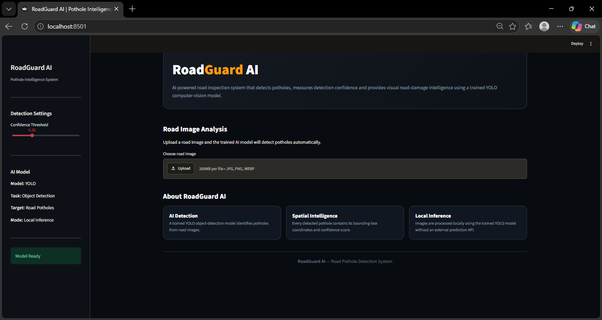

# Road Pothole Detection System

## Description
RoadGuard AI detects potholes in road images using a trained YOLO object detection model and displays bounding boxes with confidence scores. It is built for road maintenance authorities, civil engineers, and safety inspectors to automate road condition assessments.

## Live Demo
https://road-pothole-detection-system.streamlit.app

## Tech Stack
* Python
* YOLO (Ultralytics)
* OpenCV
* Pillow
* NumPy
* Streamlit

## Getting Started

### Prerequisites
Python 3.10 or higher must be installed on your computer.

### Clone the repository
```bash
git clone https://github.com/aneesofficial/Road-Pothole-Detection-System.git
cd Road-Pothole-Detection-System
```

### Install dependencies
```bash
pip install -r requirements.txt
```

### Run the application
```bash
streamlit run app.py
```

Open your browser and navigate to:
http://localhost:8501

## Environment Variables
This application does not require any environment variables or API keys. All model predictions run locally using the model file located at models/best.pt.

## Screenshots

